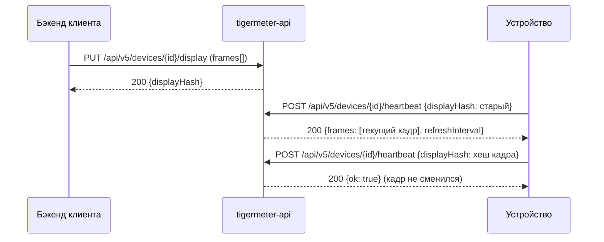

# TigerMeter

Сервер и прошивка для e-paper устройств TigerMeter. Сервер хранит для каждого устройства набор картинок (кадров) и раздаёт их устройству. Что нарисовано на кадрах, решает бэкенд клиента: он присылает готовые чёрно-белые bitmap, сервер в содержимое не заглядывает.

В репозитории:

- `node-api/` — API (Node, Fastify, Prisma);
- `web-emulator/` — Web Admin: список устройств, привязка, тест устройства, редактор кадров;
- `firmware/` — прошивка ESP32 (PlatformIO);
- `docs/` — документация API и страница прошивки через браузер.

Адреса на проде:

- API: https://api-tiger.rd1.io
- Web Admin: https://app-tiger.rd1.io
- Прошивка через браузер: https://rd1-io.github.io/tigermeter-api/

## Как это работает

1. Устройство подключается к Wi‑Fi и показывает на экране 6-значный код.
2. Код вводят в Web Admin или в приложении клиента. Устройство привязывается к клиенту (тенанту) и получает свой секрет.
3. Бэкенд клиента отправляет набор кадров: до 8 картинок, у каждой своя длительность, цвет и яркость LED, звук и вспышки.
4. Устройство периодически шлёт heartbeat (заряд, сигнал, версия прошивки) и в ответ получает текущий кадр, если он сменился.
5. Если кадров несколько, их по кругу переключает сервер: он отдаёт устройству тот кадр, который сейчас по расписанию.



## Подключение нового устройства

Устройства приходят с завода уже прошитыми. После подключения к сети и привязки устройство само обновится до последней версии прошивки: проверка идёт через минуту после включения и потом раз в час (см. «Обновление по воздуху»).

1. Включите устройство. Если Wi‑Fi не настроен, на экране будет имя сети `tigermeter-XXXX`. Подключитесь к ней с телефона (без пароля), откройте `192.168.4.1` и введите Wi‑Fi.
2. Устройство подключится к серверу и покажет 6-значный код. Код действует 5 минут, потом устройство запросит новый.
3. Откройте Web Admin → «Устройства» → «Привязка по коду», введите код и выберите клиента (обычно `tigermeter`). Клиент может сделать то же самое из своего приложения через `POST /api/v5/device-claims/{code}/attach`.
4. Через несколько секунд код с экрана пропадёт, появится «Ожидание контента». Устройство появится в списке со статусом `active`.

Если код не появляется, а в Web Admin на вкладке «На одобрении» есть MAC устройства, значит сервер его ещё не знает. Одобрите его там (или включите в «Настройках» автодобавление новых устройств), и устройство получит код при следующей попытке.

## Проверка устройства

Web Admin → карточка устройства → «Тест устройства».

- **Состояние** обновляется каждые 3 с: последний heartbeat, версия прошивки и актуальная версия, заряд, RSSI, IP, аптайм, какой кадр отдан и какой устройство подтвердило.
- **Кадр**: текст, своя картинка или одна из встроенных тестовых (рамка, сетка, шахматка, полосы, градиент, кегли, чёрный и белый экран). Превью показывает кадр 1:1, как на устройстве.
- **LED и звук**: цвет, яркость, вспышки, beep для каждого кадра.
- **Готовые сценарии**: «Все цвета LED», «Яркость LED», «Звук и вспышки», «Галерея по кругу». Кадры подписаны, чтобы сверить LED с экраном.
- **Частичное обновление**: быстрый счётчик, чтобы проверить перерисовку экрана без моргания.
- **Настройки устройства**: автообновление, демо-режим, сброс к заводским.

Минимальная проверка нового устройства: heartbeat приходит, версия прошивки актуальная, тестовая картинка «рамка и края» видна целиком, сценарий «Все цвета LED» и «Звук и вспышки» отрабатывают.

Демо-режим отключает устройство от сервера. Выключить его можно только через точку доступа устройства.

## Прошивка

**Через браузер:** откройте https://rd1-io.github.io/tigermeter-api/, подключите устройство по USB и следуйте инструкциям.

**Из репозитория:** перед первой сборкой `cp firmware/secrets.ini.example firmware/secrets.ini` и впишите `hmac_key` (тот же, что `HMAC_KEY` на сервере).

```bash
make flash             # собрать и прошить (по Wi‑Fi, если устройство найдено, иначе по USB)
make fw-build          # только собрать
make log               # serial monitor
make firmware-release  # выпустить новую версию для всех устройств
```

`make firmware-release` увеличивает номер в `firmware/version_prod.txt`, кладёт бинарники в `docs/firmware/prod/` (их раздаёт GitHub Pages) и пушит в `main`. Команда делает `git add -A`, поэтому закоммитит всё незакоммиченное.

### Обновление по воздуху

Привязанное устройство проверяет обновление через 60 с после включения и потом раз в час. Если на сервере версия новее и у устройства включено автообновление, оно скачивает прошивку и перезагружается. Запустить обновление из админки вручную нельзя.

Непривязанные устройства со старой прошивкой можно обновить партией через режим `staging`: Web Admin → «Настройки» → «Автообновление непривязанных устройств». Порядок описан в [docs/claim-flow.md](docs/claim-flow.md#автообновление-непривязанных-устройств-staging).

## API

Все маршруты начинаются с `/api/v5/`. Полная спецификация в `swagger.ru.yaml`, обзор в `docs/overview.md`.

### Доступ

Сервисы авторизуются токеном `Authorization: Bearer <token>`. Токены задаются в `.env`:

```bash
SERVICE_TOKENS='[
  {"token":"sk-ops-XXX",       "tenantId":"ops",        "scope":"ops"},
  {"token":"sk-tigermeter-YYY","tenantId":"tigermeter", "scope":"manage"}
]'
```

- `manage` — токен клиента: видит и меняет только свои устройства, чужие отдают 404.
- `ops` — токен администратора: все устройства, одобрение новых, сброс, удаление, настройки сервера.

Устройство авторизуется своим секретом, который получает один раз при привязке.

### Кадры

`PUT /api/v5/devices/{id}/display`:

```json
{
  "frames": [
    {
      "bitmap": "base64",
      "durationSec": 30,
      "ledColor": "green",
      "ledBrightness": "mid",
      "beep": false,
      "flashCount": 0,
      "refreshMode": "auto"
    }
  ],
  "refreshInterval": 60
}
```

- `bitmap` — картинка 384×168, 1 бит на пиксель, по строкам, старший бит первый, 1 = белый. Ровно 8064 байт до base64.
- `frames` — от 1 до 8 кадров. Лишние поля сервер отклоняет.
- `durationSec` — сколько показывать кадр, 1–86400 с. На деле кадр держится не меньше 10 с.
- `ledColor` — `green`, `red`, `blue`, `yellow`, `cyan`, `magenta`, `white`, `rainbow`, `off`.
- `ledBrightness` — `low`, `mid`, `high`, `off`.
- `beep`, `flashCount` (0–10) — звук и вспышки при первом показе кадра после PUT. На следующих кругах их нет; чтобы повторить, отправьте набор заново.
- `refreshMode` — `auto` (по умолчанию), `full` или `partial`. Частичное обновление экрана быстрее и без моргания; в режиме `auto` устройство периодически делает полное, чтобы убрать остаточное изображение.
- `refreshInterval` — максимальный период heartbeat, 10–3600 с. При нескольких кадрах сервер сам укорачивает интервал, чтобы устройство пришло к смене кадра.

Ответ: `{ displayHash, displayVersion }`. Кадр сменяется на устройстве с точностью в несколько секунд; без связи он не меняется.

Как идёт доставка, видно в `GET /api/v5/devices/{id}`: `rotation` (какой кадр сейчас по расписанию и когда смена), `deliveredFrameIndex` (какой отдан), `deviceFrameIndex` (какой устройство подтвердило).

### Привязка

1. Устройство: `POST /api/v5/device-claims` с MAC и HMAC → `{ code, expiresAt }`.
2. Клиент: `POST /api/v5/device-claims/{code}/attach` с токеном `manage` и `{ "externalUserId": "..." }`. `externalUserId` — id пользователя у клиента, сервер хранит его для справки.
3. Устройство опрашивает `GET /api/v5/device-claims/{code}/poll` и после привязки один раз получает секрет.

Администратор привязывает через `POST /api/v5/admin/device-claims/{code}/attach` с `{ "tenantId": "tigermeter" }`. Подробности и ошибки — в `docs/claim-flow.md` и `docs/errors.md`.

## Разработка

```bash
make setup     # зависимости, .env и secrets.ini из примеров, локальная БД
make dev       # API на http://127.0.0.1:3001
make emulator  # Web Admin на http://localhost:5175
```

Локально используется SQLite (`node-api/prisma/dev.db`). Порядок изменения API описан в `CONTRIBUTING.md`.

### Пример: от кода до кадра

```bash
export BASE=http://127.0.0.1:3001
export SERVICE_TOKEN=sk-tigermeter-XXX
export HMAC_KEY=change-me-dev-hmac

# 1. Код (обычно его запрашивает устройство)
BODY=$(node -e '
const { createHmac } = require("crypto");
const mac = "AA:BB:CC:DD:EE:FF", fw = "v40", ts = Date.now();
const hmac = createHmac("sha256", process.env.HMAC_KEY).update(`${mac}:${fw}:${ts}`).digest("hex");
console.log(JSON.stringify({ mac, firmwareVersion: fw, timestamp: ts, hmac }));')
CODE=$(curl -s "$BASE/api/v5/device-claims" -H 'content-type: application/json' -d "$BODY" | jq -r .code)

# 2. Привязка
curl -s -X POST "$BASE/api/v5/device-claims/$CODE/attach" \
  -H "authorization: Bearer $SERVICE_TOKEN" -H 'content-type: application/json' \
  -d '{"externalUserId":"user-12345"}'

# 3. Секрет устройства
CLAIM=$(curl -s "$BASE/api/v5/device-claims/$CODE/poll")
DID=$(echo "$CLAIM" | jq -r .deviceId)
DEVSECRET=$(echo "$CLAIM" | jq -r .deviceSecret)

# 4. Кадр
BITMAP=$(node -e "console.log(Buffer.alloc(8064).toString('base64'))")
curl -s -X PUT "$BASE/api/v5/devices/$DID/display" \
  -H "authorization: Bearer $SERVICE_TOKEN" -H 'content-type: application/json' \
  -d "{\"frames\":[{\"bitmap\":\"$BITMAP\",\"durationSec\":30,\"ledColor\":\"green\",\"ledBrightness\":\"mid\"}],\"refreshInterval\":60}"

# 5. Heartbeat от имени устройства
curl -s "$BASE/api/v5/devices/$DID/heartbeat" \
  -H "authorization: Bearer $DEVSECRET" -H 'content-type: application/json' \
  -d '{"battery":95,"rssi":-55,"displayHash":""}'
```

Если устройства с таким MAC нет в базе, шаг 1 вернёт 404, а MAC появится в «На одобрении». Для локальной разработки включите автодобавление в «Настройках» Web Admin.

## Деплой

Push в `main` запускает GitHub Actions (`.github/workflows/deploy.yml`): собирается Web Admin, API доставляется на прод-сервер, перезапускается docker compose и проверяется health. Актуальная версия прошивки на сервере берётся из `firmware/version_prod.txt` при каждом деплое.

Доступ к серверу хранится в secrets репозитория: `PVE_HOST`, `PVE_PORT`, `PVE_USER`, `PVE_SSH_KEY`.

## Документация

- `docs/overview.md` — обзор API
- `docs/claim-flow.md` — привязка, выдача секрета, режим `staging`
- `docs/errors.md` — ошибки и лимиты
- `swagger.ru.yaml` — спецификация OpenAPI
